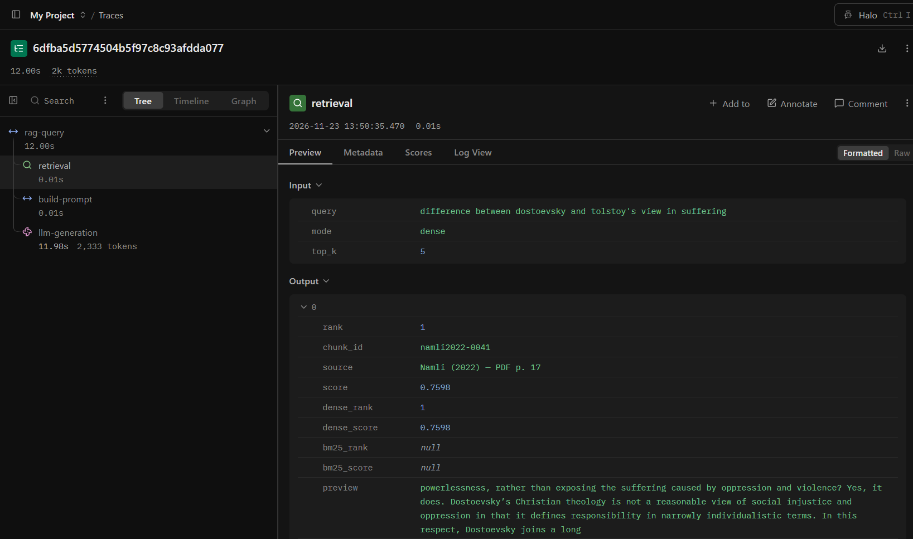

# Karamazov RAG — question answering over *The Brothers Karamazov* and five scholarly papers

*A personal exploration of Retrieval-Augmented Generation: building a small, fully traceable RAG system end to end, then studying where and why it fails.*

A Retrieval-Augmented Generation system that answers questions about Dostoevsky's *The Brothers Karamazov* (Garnett translation) and five open-access papers about it, citing the chapter or PDF page each answer comes from.
Everything runs in one Google Colab notebook on a free T4 GPU with free, open models.

**Exploration focus:** *evaluation and failure analysis*. Using retrieval metrics, end-to-end answer checks, a closed-book baseline and Langfuse traces, I separate **retrieval failures** from **generation failures** and compare dense, BM25 and hybrid retrieval.

---

## Contents
1. [Problem and scope](#1-problem-and-scope)
2. [Document collection](#2-document-collection)
3. [Architecture](#3-architecture)
4. [Models and tools](#4-models-and-tools)
5. [Setup and running](#5-setup-and-running)
6. [Saved outputs](#6-saved-outputs)
7. [Baseline demonstration](#7-baseline-demonstration)
8. [Exploration: evaluation and failure analysis](#8-exploration-evaluation-and-failure-analysis)
9. [Design decisions](#9-design-decisions)
10. [Limitations](#10-limitations)
11. [What I would investigate next](#11-what-i-would-investigate-next-proposed-not-tested)
12. [References](#12-references)

---

## 1. Problem and scope

**Task:** answer natural-language questions about a long novel and scholarly writing about it, using only evidence retrieved from the collection, with references a reader can check.

**Why this collection:**
- **Many passages:** about 350k words across 96 chapters. The same events are told several times (e.g. the murder, by different characters and then at the trial), so retrieval has to choose between competing passages.
- **More than one document:** questions can need both the novel and a paper ("What does the Grand Inquisitor claim, and how does Admirand interpret it?").
- **Built-in retrieval difficulties:** characters go by several names (*Alyosha / Alexey / Aleksei*, *Mitya / Dmitri*), and the translation spells the elder "**Zossima**" while most papers write "**Zosima**".
- **Free to use:** the novel is public domain and the papers are openly licensed (§2).

**Scope:** a command-line style interface inside a Colab notebook. There is no GUI or deployment; the goal was to understand the system, not to ship it.

---

## 2. Document collection

| doc_id | Document | File | License | Size after preprocessing | Chunks |
|---|---|---|---|---|---|
| `karamazov` | F. Dostoevsky, *The Brothers Karamazov*, trans. Constance Garnett (1912). **Standard Ebooks** edition | EPUB | Public domain in the US; Standard Ebooks' contributions dedicated under CC0 1.0 | Epigraph + 96 chapters, 349,700 words | 1,521 |
| `osinska2021` | Osińska, K. & Szejko, N. (2021). *The Mystery of the Crime in Skotoprigonyevsk: Plot Analysis of The Brothers Karamazov from the Perspective of Literature Studies, Psychology and Psychiatry.* Preprints.org 202111.0493 | PDF | CC BY 4.0 | 16 of 18 pages, 6,970 words | 31 |
| `love_teaching2018` | Roberts, P. (2018). *Love, attention and teaching: Dostoevsky's The Brothers Karamazov.* Open Review of Educational Research 5(1), 1–15 | PDF | CC BY | 14 of 16 pages, 8,118 words | 40 |
| `admirand2021` | Admirand, P. (2021). *Theist–Atheist Encounters in Les Misérables, The Brothers Karamazov, and The Plague.* Religions 12(1), 12 | PDF | CC BY | 20 of 23 pages, 14,035 words | 69 |
| `namli2022` | Namli, E. (2022). *The Brothers Karamazov and the theology of suffering.* Studies in East European Thought 74, 19–36 | PDF | CC BY 4.0 | 18 of 18 pages, 9,394 words | 44 |
| `gabor2024` | Gabor, O. (2024). *The Problem of Evil and Fr. Zosima's Responsibility Before All.* Review of Ecumenical Studies 16(1), 121–134 | PDF | CC BY-NC-ND 4.0 | 14 of 14 pages, 5,948 words | 30 |
| | **Total** | 1 EPUB + 5 PDF | | **≈394k words** | **1,735** |

"Pages kept" means pages left after cutting the reference list (§3.1).

**Provenance notes:**
- **Novel:** I first planned to use Project Gutenberg #28054, but Gutenberg was unavailable during the project. The Standard Ebooks edition is based on the Gutenberg transcription and proofread against page scans. I rejected a different EPUB (epubBooks, 2014) because its copyright page forbids storing the text "in any information storage and retrieval system", which is exactly what a RAG index does.
- **Osińska & Szejko:** the Preprints.org download link returned 404, so the same CC BY preprint was downloaded from ResearchGate.
- **Manual downloads:** Gutenberg, MDPI, Taylor & Francis and Springer all blocked automated downloads from Colab (HTTP 403/503, or an HTML page instead of a PDF). All six files were therefore downloaded in a browser and are read from a Google Drive folder. **The files are not redistributed in this repository**, partly because of the ND clause on Gabor (2024). §5 lists the sources.
- **Translations differ:** the papers quote other translations (Pevear & Volokhonsky, Avsey), so names and quoted wording do not always match the Garnett text.

---

## 3. Architecture

```
                           ┌───────────── ingestion (once) ─────────────┐
 EPUB (novel) ──► structural parse (Part › Book › Chapter) ─┐
                                                            ├─► chunking ─► embeddings ─► FAISS (exact cosine)
 PDF ×5 ─► page-level text, header/footer & refs removed ───┘   400 tok,      bge-base     └─► BM25 index
                                                                 60 overlap
 question ─► retrieve top-k=5 (dense | bm25 | hybrid-RRF) ─► prompt with [S1]..[S5] + location labels
          ─► Qwen3-4B-Instruct (greedy) ─► answer with [S#] citations
          ─► citation check (valid / invalid / uncited / abstained) ─► runs.jsonl + Langfuse trace
```

### 3.1 Ingestion
- **Novel (EPUB):** the Standard Ebooks EPUB marks every division explicitly (`<section role="doc-chapter">`, with an `<hgroup>` holding the chapter number and title, and Part, Book and Epilogue sections identified by id). The parser reads that structure instead of guessing headings from text, so every chunk gets an exact location such as `Part II › Book V. Pro and Contra › Chapter V. The Grand Inquisitor`. The epigraph is kept. Endnote markers, endnotes, colophon, imprint and licence pages are removed, as are invisible formatting characters (U+FEFF). A regex-based text parser remains as a fallback for EPUBs or `.txt` files without this markup.
- **Papers (PDF, PyMuPDF):** text is extracted **page by page**, so every chunk keeps an exact PDF page number. Text blocks are read in sorted reading order, which helps with two-column layouts. Short blocks that repeat on at least 40% of pages (running headers and footers such as journal name, DOI or licence line) and bare page numbers are removed. Words hyphenated across a line break are re-joined. Everything from the "References/Bibliography" heading onward is cut, because bibliography entries match many queries but never answer them.
- **Chunking:** paragraphs are packed greedily up to **400 tokens**. A paragraph longer than that is split at sentence boundaries. **60 tokens of overlap** are carried into the next chunk. Chunks **never cross a chapter or a PDF page**, so each one has a single location to cite. Token counts use the **embedding model's tokenizer**, so no chunk is silently cut off at BGE's 512-token limit. The resulting median is 357 tokens per chunk, and the maximum is 400.
- **Metadata per chunk:** `chunk_id` (e.g. `karamazov-0486`), `doc_id`, document short name, `location` (Part › Book › Chapter, or `PDF p. N`), and `page`. A header `"<doc> | <location>"` is prepended to the text **before embedding only**, so a query that names a chapter or author can match it.

### 3.2 Retrieval
| Mode | How it works |
|---|---|
| `dense` | `bge-base-en-v1.5` embeddings (768-d, L2-normalised), compared by exact inner product in `faiss.IndexFlatIP`, which equals cosine similarity. Queries get BGE's recommended instruction prefix. With 1,735 chunks, exact search takes milliseconds, so an approximate index would only add error. |
| `bm25` | `rank_bm25` (Okapi BM25) over lowercase word tokens with stop-words removed |
| `hybrid` | Each retriever returns its top 20 (`candidate_k`), and the two lists are merged with **Reciprocal Rank Fusion**: score(d) = Σ 1/(60 + rank). Only ranks are used, so the different score scales of cosine and BM25 don't need calibrating. Chunks that both retrievers rank highly win. |

Key settings are `top_k = 5`, `candidate_k = 20` and `rrf_k = 60`. Every hit is logged with its score, its rank in each retriever, its location and its text.

### 3.3 Answer generation
- **Prompt:** the system prompt requires the model to use **only** the numbered sources, cite every claim as `[S#]`, say *"The provided sources do not contain enough information to answer this."* when the evidence is missing, mention disagreement between sources, and stay under about 150 words. It also lists the name variants (Zossima = Zosima, Mitya = Dmitri, …). Each source appears as `[S1] <document> — <location> (chunk <id>)` followed by its text.
- **Context limit:** sources are added in rank order until **3,000 tokens** (counted with the LLM tokenizer) would be exceeded. In practice the context had a median of 1,752 tokens and a maximum of 2,097, so nothing was ever dropped.
- **Decoding:** greedy (`do_sample=False`, which makes runs reproducible), at most 400 new tokens, fp16 on a T4.

### 3.4 Source attribution
- Citations look like `The Brothers Karamazov (Garnett) — Part IV › Book XII. A Judicial Error › Chapter XIV. The Peasants Stand Firm` or `Namli (2022) — PDF p. 8`, always with the chunk id.
- A post-processing step maps each `[S#]` (or `(S#)`) in the answer back to the chunk that was actually in the prompt. It flags **invalid citations** (a source number that doesn't exist), **uncited answers**, and **abstentions**. So the references shown always correspond to evidence that was really retrieved.

### 3.5 Observability
Every question produces one **Langfuse** trace (SDK v5) with three child observations:
- `retrieval` (type retriever): query, mode, every hit's id, location, scores and per-retriever ranks
- `build-prompt`: which passages were used or dropped by the budget, and the context token count
- `llm-generation` (type generation): full prompt, answer, model, decoding parameters, token usage, latency

The same record is always appended to `outputs/runs.jsonl`, so the runs can be inspected without Langfuse access.



### Tracing one question (q02, hybrid)
*"What story about a serf boy and a general's hounds does Ivan tell Alyosha, and why does he tell it?"*
1. The query is embedded (with the BGE query prefix) and BM25-tokenised. Each retriever returns its top 20, and RRF merges them. Retrieval took 20 ms.
2. Fused top 5, with ranks from each retriever:

   | # | chunk | location | dense rank | BM25 rank | RRF |
   |---|---|---|---|---|---|
   | S1 | `admirand2021-0044` | Admirand (2021), PDF p. 13 (retells the story) | 2 | 1 | 0.0325 |
   | S2 | `karamazov-0462` | Part II › Book V › Chapter IV. Rebellion | 1 | 3 | 0.0323 |
   | S3 | `karamazov-0463` | Part II › Book V › Chapter IV. Rebellion (the hounds scene) | 3 | 4 | 0.0315 |
   | S4 | `gabor2024-0013` | Gabor (2024), PDF p. 6 | 11 | 2 | 0.0302 |
   | S5 | `karamazov-1105` | Part IV › Book XI › Chapter I | 7 | 8 | 0.0296 |
3. All 5 passages fit in the prompt: 1,577 context tokens, well under the 3,000 budget.
4. Qwen3-4B generates the answer in 10.4 s, citing [S1]–[S4].
5. The citation check finds 4 valid citations, 0 invalid, and the gold chapter (*Rebellion*) is cited ✓. The trace is in Langfuse and in `runs.jsonl`.

---

## 4. Models and tools

| Component | Choice (exact name) | Why |
|---|---|---|
| LLM | **`Qwen/Qwen3-4B-Instruct-2507`** (Hugging Face, Apache-2.0), fp16 | Fits a free Colab T4 (~8 GB in fp16); strong instruction following for its size; the *Instruct-2507* variant has no hidden "thinking" output to strip; long context. Swappable via `RAG_LLM_MODEL`. |
| Embeddings | **`BAAI/bge-base-en-v1.5`** (MIT) via `sentence-transformers` | Well-established English retrieval model; 768-d; fast on a T4 (1,735 chunks embedded in 37 s); 512-token input limit matches the 400-token chunks. Swappable via `RAG_EMBED_MODEL`. |
| Vector store | **FAISS** `IndexFlatIP` (`faiss-cpu`) | Exact search; no server; plenty fast at this size |
| Sparse retrieval | `rank_bm25` (`BM25Okapi`) | Simple, transparent baseline for exact names and spellings |
| Parsing | `ebooklib` + `beautifulsoup4` (EPUB), `pymupdf` (PDF) | Structure-aware EPUB parsing; page-level PDF text with block positions |
| Observability | **Langfuse** cloud (free tier), Python SDK `langfuse>=5,<6` | Trace tree per query; also mirrored to local JSONL |
| Runtime | Google Colab, **T4 GPU (16 GB)**, `transformers 5.22.1` | Free GPU; no local setup |

Dependencies are listed in `requirements.txt`; the reported run used `transformers 5.22.1` on a Colab T4.

---

## 5. Setup and running

**Hardware:** an NVIDIA GPU with at least about 10 GB VRAM. The free Colab T4 is enough. On a CPU it works but is very slow; use a smaller model there (`RAG_LLM_MODEL=Qwen/Qwen2.5-1.5B-Instruct`) or set `RAG_LLM_4BIT=true`. Expect the first run to take about 10 minutes for downloads and embedding, then about 10 s per question.

**Steps (Google Colab):**
1. Download the six documents in a browser and put them in **`MyDrive/karamazov_rag_data/`**:
   ```
   fyodor-dostoevsky_the-brothers-karamazov_constance-garnett.epub   ← standardebooks.org/ebooks/fyodor-dostoevsky/the-brothers-karamazov/constance-garnett
   osinska2021.pdf        ← preprints.org/manuscript/202111.0493
   love_teaching2018.pdf  ← doi.org/10.1080/23265507.2017.1404434
   admirand2021.pdf       ← mdpi.com/2077-1444/12/1/12
   namli2022.pdf          ← doi.org/10.1007/s11212-021-09454-x
   gabor2024.pdf          ← doi.org/10.2478/ress-2024-0009
   ```
   Keep only **one** novel file in the folder. The PDF names must match exactly.
2. Open `karamazov_rag.ipynb` in Colab and choose *Runtime → Change runtime type → T4 GPU*.
3. *(Optional)* In Colab **Secrets** (🔑), add `LANGFUSE_PUBLIC_KEY`, `LANGFUSE_SECRET_KEY` and `LANGFUSE_BASE_URL`. Without them, tracing falls back to local JSONL. Add `HF_TOKEN` only if you use a gated model.
4. Choose *Runtime → Run all* and allow Google Drive access when asked. When the interactive loop prompts `Question:`, ask questions or press **Enter on an empty line** to continue.

**Asking questions:** use the interactive cell (*§11, Try it*). Type a question, type `:mode dense|bm25|hybrid` to switch retrieval, or press Enter on an empty line to quit. Each answer prints the cited sources and all retrieved passages with their scores.

**Configuration:** every setting is in the `Config` dataclass and can be overridden with environment variables (see `.env.example`). Nothing model-specific is hard-coded:

| Variable | Default | Meaning |
|---|---|---|
| `RAG_LLM_MODEL` | `Qwen/Qwen3-4B-Instruct-2507` | any Hugging Face chat model |
| `RAG_LLM_4BIT` | `false` | 4-bit loading (bitsandbytes) for small GPUs |
| `RAG_EMBED_MODEL` / `RAG_EMBED_QUERY_PREFIX` | `BAAI/bge-base-en-v1.5` / BGE instruction | embedding model and its query prefix |
| `RAG_CHUNK_SIZE` / `RAG_CHUNK_OVERLAP` | `400` / `60` | chunk size and overlap in tokens |
| `RAG_RETRIEVAL_MODE` / `RAG_TOP_K` | `dense` / `5` | default retrieval mode and number of passages |
| `RAG_MAX_CONTEXT_TOKENS` / `RAG_MAX_NEW_TOKENS` | `3000` / `400` | context budget and answer length |
| `RAG_USE_LANGFUSE` | `auto` | `auto` turns tracing on if keys exist; also `on` or `off` |

The default `RAG_RETRIEVAL_MODE` is `dense` (the baseline). Based on §8, **`hybrid` is the recommended setting** for the demo.

---

## 6. Saved outputs

All in `outputs/`, readable without running anything:

| File | Content |
|---|---|
| `eval_report_hybrid.md`, `eval_report_dense.md` | For each of the 18 eval questions: retrieval metrics, answer, cited sources and all 5 retrieved passages |
| `eval_summary_hybrid.csv`, `eval_summary_dense.csv` | One row per question: hit, recall, MRR, abstained, cites_gold, citation counts, latency |
| `eval_results_*.jsonl` | Full records, including passage texts and scores |
| `retrieval_comparison.csv` | Hit, recall and MRR at k=5 for dense, BM25 and hybrid (no LLM involved) |
| `closed_book_baseline.md` | The same LLM answering the same questions **without retrieval** |
| `runs.jsonl` | Every query run (45): eval, demo and interactive questions, each with its full trace record. Langfuse trace links were removed because they point to a private project. |

---

## 7. Baseline demonstration

Taken from `eval_report_hybrid.md` and `runs.jsonl`. Retrieved passages are shortened here; the reports contain them in full.

### Works well
**q09 — "What does Alyosha ask the boys to remember in his speech after Ilusha's funeral?"** (single passage)
- Retrieved: 4 of 5 chunks come from `Epilogue › Chapter III. Ilusha's Funeral. The Speech at the Stone`, e.g. *"…And so in the first place, we will remember him, boys, all our lives…"*
- Answer: remember Ilusha and one another, his bravery in standing up for his father, and how good it was to be together; be kind, honest and never forget each other [S1][S3]. ✅ Correct, and it cites the gold chapter.

**q14 — "Which other novels does Admirand compare with The Brothers Karamazov…?"** (paper)
- Retrieved: `Admirand (2021) — PDF p. 1` (the title and abstract).
- Answer: *Les Misérables* and *The Plague* [S1]. ✅

**q16 — "What does the Grand Inquisitor claim in the novel, and how does Admirand interpret that chapter?"** (cross-document)
- Hybrid retrieved both the novel's *Grand Inquisitor* chapter and Admirand pp. 13–14. Dense retrieved only the novel, so recall was 0.5 for dense and 1.0 for hybrid.
- Answer: the Inquisitor's claims about freedom and "miracle, mystery and authority", plus Admirand's reading (a critique of totalitarian control, with a parallel to Juvenal's "bread and circuses") [S2][S4]. ✅

### Struggles
| Question | What happened | Failure type |
|---|---|---|
| **q05** *"What does **Zosima** say about love in action compared with love in dreams?"* | The novel's own passage (`Book II › Chapter IV. A Lady of Little Faith`, where the elder is spelled **Zossima**) was not in the top 5 for dense or hybrid; only papers spelling it "Zosima" were. The answer is plausible but comes from Roberts (2018), a secondary source. BM25 alone ranks the right chapter #1. | **Retrieval:** spelling mismatch |
| **q08** *"What was the jury's verdict at Mitya's trial?"* | No retrieval mode found `Book XII › Chapter XIV. The Peasants Stand Firm`. The answer relies on Osińska & Szejko p. 3 and says Mitya was condemned to **ten** years of penal servitude. The novel says **twenty** (*"condemned to penal servitude for twenty years"*, Epilogue › Ch. I). The citation is faithful to the paper, but the paper is wrong about the novel. | **Retrieval miss + secondary-source error** |
| **q06** *"Who was Smerdyakov's mother, and what happened to her?"* | Hybrid retrieved `Book III › Chapter II. Lizaveta` at rank 5, and that chunk says Lizaveta died at dawn after giving birth and the baby was christened Pavel. The model still answered "not enough information". | **Generation:** ignored evidence that was present |
| **CLI** *"why aleksei leaves monastery"* (dense) | The answer blames his crisis over Zossima's death. In the novel, the elder tells him to go out into the world. The spelling "Aleksei" doesn't appear in the Garnett text. | **Retrieval:** name variant |

### Insufficient evidence
- **q17** *"How many copies did the first edition sell?"* → *"The provided sources do not contain enough information…"* ✅ (both modes)
- **q18** *"What happens to Mitya after he escapes to America?"* → abstains, and correctly notes that the escape is only planned in the novel. ✅
- **CLI** *"did dostoevsky win any prize for this book"* → abstains, with no made-up prize. ✅

---

## 8. Exploration: evaluation and failure analysis

**Question:** when an answer is wrong, did **retrieval** fail (the evidence never reached the model) or did **generation** fail (the evidence was there and the model misused it)? And which retrieval mode fails least?

### 8.1 Method
- **18 questions** (`EVAL_SET` in the notebook): 9 single-passage, 1 cross-passage, 1 spelling-variant probe, 4 paper, 2 cross-document, and 2 the collection can't answer.
- **Gold labels describe where the evidence is, not the answer text.** They name a chapter title (e.g. `Book III` + `Lizaveta`) or a paper id. A retrieved chunk matches if all of a target's strings appear in its `doc_id + location`, using whole-word matching so that "Book XI" doesn't match "Book XII". I checked every novel target against the parsed chapter list: each matches the intended chapter (q10's targets intentionally match the Book XI Smerdyakov interviews and Book XII).
- **Retrieval metrics at k=5:** Hit (any target retrieved), Recall (share of targets retrieved; matters for multi-target questions), MRR (1/rank of the first relevant chunk).
- **Generation checks:** abstained?, cites a gold chunk?, invalid citations?, uncited answer?
- **Closed-book baseline:** the same LLM with no retrieval.
- **Manual review** of every answer against the novel and papers (§8.4).

### 8.2 Retrieval comparison (16 answerable questions, k=5, no LLM involved)
| Mode | Hit@5 | Recall@5 | MRR |
|---|---|---|---|
| dense | 0.812 | 0.750 | 0.762 |
| BM25 | **0.875** | **0.812** | **0.771** |
| hybrid (RRF) | **0.875** | **0.812** | 0.674 |

Per question (recall), the modes differ only here:

| | dense | BM25 | hybrid | Why |
|---|---|---|---|---|
| q05 alias "Zosima" | 0 | **1** | 0 | Only BM25 matches the exact name "Zossima", which appears in the chunk header and text |
| q06 Smerdyakov's mother | 0 | 0 | **1** | Fusion: the Lizaveta chunk was mid-ranked by both retrievers, and the summed RRF score lifted it into the top 5 |
| q10 confession vs prosecutor | 0.5 | **1** | 0.5 | Only BM25 also retrieved a Book XI Smerdyakov interview chapter |
| q15 Gabor vs Namli | **1** | 0.5 | 0.5 | Dense found a Namli chunk; BM25 and hybrid retrieved only one of the two papers (hybrid: five Gabor chunks) |
| q16 Inquisitor + Admirand | 0.5 | 0.5 | **1** | Each retriever found one of the two sources, and fusion kept both |
| q08 verdict | 0 | 0 | 0 | All modes miss; a paraphrased summary in Osińska outranks the chapter |

**What this shows:** hybrid and BM25 recover more evidence than dense (recall 0.812 vs 0.750), and hybrid is the only mode that gets both sources for q16 and the Lizaveta passage for q06. But hybrid has the **lowest MRR** (0.674): RRF rewards chunks that both retrievers rank moderately well over a chunk that one retriever ranks #1. q05 shows this directly: BM25's correct #1 is outvoted by paper chunks that both retrievers like. **No single mode wins everywhere.** With 16 questions, a difference of one question is 0.0625, so these differences point in a direction but aren't statistically conclusive.

### 8.3 End-to-end comparison (same 18 questions, LLM included)
| | dense | hybrid |
|---|---|---|
| Answer cites a gold chunk (16 answerable) | 11 | **12** |
| Abstained on an answerable question | 4 (q01, q03, q06, q15) | **3** (q04*, q06, q15) |
| Abstained on unanswerable (q17, q18) | 2 / 2 ✅ | 2 / 2 ✅ |
| Invalid citations / uncited answers | 0 / 0 | 0 / 0 |
| Median latency per question | 10.2 s | 9.7 s |

\* q04 (hybrid) answered and then added an abstention sentence, so the regex counts it as abstained. It's really a partial answer (§8.4).

**Latency** (45 traced runs): retrieval takes a median of **17 ms**, generation about **10 s**, so **generation is 99.5% of the time**. Changing the retrieval mode doesn't affect latency noticeably.

### 8.4 Failure analysis: retrieval vs generation (from the traces)
| Q | Mode | Evidence in the prompt? | What the model did | Category |
|---|---|---|---|---|
| q03 | dense | Yes, *Breath of Corruption* at rank **5** | Said the sources don't mention what happened to the body | **Generation:** ignored evidence at the last position |
| q03 | hybrid | Yes, two chunks of that chapter at ranks 4–5 | Correct, cited the gold chapter | ✅ More supporting chunks helped |
| q06 | hybrid | Yes, the Lizaveta chunk at rank **5** (she died at dawn after giving birth) | Abstained | **Generation:** ignored evidence at the last position |
| q06 | dense | No, only later Smerdyakov chapters | Abstained | **Retrieval** (abstaining was correct here) |
| q01 | dense | Right chapter, **wrong chunks**: the "three powers… miracle, mystery and authority" sentence wasn't in any retrieved chunk | Abstained | **Retrieval at chunk level**, which the chapter-level gold label scores as a hit |
| q01 | hybrid | Yes, the novel chunk with "three powers" at rank 3, plus a paper paraphrase | Correct, but cited the paper, not the novel | Correct; **source preference** |
| q04 | hybrid | Partly: the waking scene, but not the dream of Cana itself | "Alyosha does not have a vision…" | **Retrieval (chunk level) + over-literal generation** |
| q15 | dense | Yes, Namli p. 4 at rank 1 | "Namli does not directly address…" | **Generation** |
| q15 | hybrid | No Namli chunk | Abstained on the Namli half | **Retrieval** (honest abstention) |
| q08 | both | No, the verdict chapter was missed | Repeated the paper's "ten years" (the novel says twenty) | **Retrieval + secondary-source error** |
| q10 | hybrid | Half: the defence speech (Book XII) and Osińska's summary, but not the confession chapter (Book XI) | Mixed up details: said the confession was made "during a severe epileptic seizure", but the paper puts the seizure on the night of the murder | **Retrieval gap → generation error** |
| q05 | dense, hybrid | No, only papers | Plausible answer from a secondary source | **Retrieval:** spelling variant |

**Patterns:**
1. **Retrieval failures** (q05, q08, q06-dense, q15-hybrid) are mostly about **vocabulary**: spelling variants, or summaries that outrank the original wording. They're also the most damaging case: a fluent answer built on a secondary source (q05, q08) passes every automatic check.
2. **Generation failures** happen when evidence is present but **ranked last or alone**. q03-dense and q06-hybrid ignored a single supporting chunk at rank 5, while two supporting chunks (q03-hybrid) worked. This is a **hypothesis from two cases, not a finding** (§11).
3. **Chapter-level gold labels are too coarse:** q01-dense counts as a retrieval hit, but the sentence that answers it was never retrieved.
4. **Faithful is not the same as correct:** q08's citation is accurate to the paper, but the paper misstates the novel. When papers and the novel share an index, an answer can be traced to its source and still be wrong about the novel.
5. **The abstention rule works for truly unanswerable questions** (2/2, plus the prize question) and **never** produced invalid citations. Its cost is over-abstention on 3–4 answerable questions.

### 8.5 Does the model already know the novel? (closed-book baseline)
A worry with a famous novel is that the LLM answers from memory, which would hide retrieval failures. `outputs/closed_book_baseline.md` shows that this 4B model knows very little: **7 of the 16 answerable questions got "I don't know"**, and most of the rest were confidently wrong. For example, it denied that Ivan tells the serf-boy story (q02), said Smerdyakov's mother is "not a known character" (q06), named Alyosha as the murder victim (q10), dated the novel to 1869 (q17), and said "Admirand" isn't a known scholar (q16). At best two answers (q05, q09) were roughly right in gist. The correct, specific details in the RAG answers therefore come from retrieval. That makes the retrieval-vs-generation analysis above meaningful for this model; for a larger model, memorisation would need re-checking.

### 8.6 Conclusion of the exploration
- **Hybrid retrieval** improved evidence recall (0.750 → 0.812) and answer grounding (11 → 12 gold-cited answers, 4 → 3 over-abstentions) compared with the dense baseline, at no latency cost. It's the recommended mode, with the known weakness that RRF can outvote a single strong BM25 hit.
- The remaining errors split roughly evenly between **retrieval** (name variants, secondary sources outranking the primary text) and **generation** (ignoring the last-ranked evidence). The traces were needed to tell them apart, since the automatic metrics alone mis-scored q01 and q04.

---

## 9. Design decisions

| Decision | Alternative considered | Reason |
|---|---|---|
| Chunks never cross a chapter or PDF page | Fixed-size windows over the whole text | Every chunk has exactly one citable location. The cost: a passage that straddles a page boundary is split. |
| 400-token chunks, 60 overlap, measured with the embedder's tokenizer | 200 or 800 tokens | Stays under BGE's 512-token limit with room for the header. Five chunks fit easily in the context budget. |
| Structural EPUB parsing | Regex on extracted text | The heading styles differed between editions (Gutenberg, epubBooks, Standard Ebooks), and the regex parser mislabelled the Epilogue as Book XII on one edition. The markup is unambiguous. |
| Header (`doc | location`) embedded with each chunk | Text only | Lets "the Grand Inquisitor chapter" or "Namli" match by name. Downside: chapter titles can also bias retrieval. |
| Exact FAISS search | HNSW / IVF | 1,735 vectors take milliseconds to search exactly; an approximate index would only add recall loss. |
| RRF for hybrid | Weighted score sum | No need to calibrate cosine against BM25 scores |
| Greedy decoding | Sampling | Reproducible answers for evaluation |
| Explicit abstention sentence + regex detection | A learned verifier | Simple and transparent. Its limitation is the false positive on partial answers (q04). |
| Colab notebook | Python package + CLI | Free GPU and one-click reproducibility for anyone who wants to run it. In a real deployment I would split ingestion, the index, an inference server and an API. |

---

## 10. Limitations
- **Small evaluation set:** 18 questions with my own gold labels. The differences between modes are 1–2 questions, so they point in a direction but aren't conclusive. The manual correctness judgments are mine and haven't been double-checked by a second person.
- **Chapter-level gold labels** can't tell whether the answering *sentence* was retrieved (q01-dense).
- **Translation mismatch:** the papers quote other translations, so quoted wording and names differ from the Garnett text.
- **The abstention detector is a regex.** It counts partial answers as abstentions (q04).
- **PDF page numbers are PDF pages,** not the journal's printed page numbers (e.g. Namli's printed pages are 19–36).
- **Hardware and runtime:** a GPU is needed for usable speed, and Colab sessions are temporary. Documents have to be placed in Drive by hand.
- **One model size:** the conclusions about memorisation and over-abstention apply to this 4B model only.

---

## 11. What I would investigate next (proposed, not tested)
| Observed problem | Proposed experiment | How I would measure it |
|---|---|---|
| Single evidence chunk at rank 5 ignored (q03-dense, q06-hybrid) | **Reorder the context**: put the best chunk last (nearest the question) or first, and test whether position matters | Abstention and gold-cited rate on the same 18 questions; add 10 more questions where the evidence sits in a single chunk |
| Spelling variants (Zosima/Zossima, Aleksei/Alyosha) | **Query expansion** with a small alias dictionary, or **weighted RRF** that favours BM25 for queries with proper names | Recall on q05 and a set of alias questions |
| Right chapter, wrong chunk; scores bunched together (0.6–0.7) | **Cross-encoder reranker** (e.g. `BAAI/bge-reranker-base`) over the top 20 | MRR and sentence-level hit rate (needs sentence-level gold labels) |
| Secondary sources outranking the novel (q05, q08) | **Metadata routing**: prefer `doc_type = novel` for plot questions, papers for questions naming a scholar | Share of answers citing the primary source; error rate on factual plot questions |
| Cross-document recall 0.5 | **Query decomposition**: one retrieval per named source | Recall on q15, q16 and more cross-document questions |
| Coarse evaluation | **Sentence-level gold labels**, a larger question set, and a second annotator | Agreement between annotators; confidence intervals on the mode comparison |

---

## 12. References
**Documents:** see §2.

**Models and tools**
- Qwen Team. *Qwen3-4B-Instruct-2507.* huggingface.co/Qwen/Qwen3-4B-Instruct-2507
- Xiao, S. et al. (2023). *C-Pack: Packaged Resources To Advance General Chinese Embedding* (BGE models). huggingface.co/BAAI/bge-base-en-v1.5
- Johnson, J., Douze, M. & Jégou, H. (2019). *Billion-scale similarity search with GPUs* (FAISS).
- Robertson, S. & Zaragoza, H. (2009). *The Probabilistic Relevance Framework: BM25 and Beyond.*
- Cormack, G. V., Clarke, C. L. A. & Büttcher, S. (2009). *Reciprocal Rank Fusion outperforms Condorcet and individual rank learning methods.* SIGIR.
- Gao, Y. et al. (2023). *Retrieval-Augmented Generation for Large Language Models: A Survey.* arXiv:2312.10997. *(naive / advanced / modular RAG framing)*
- Langfuse. langfuse.com · Standard Ebooks. standardebooks.org
